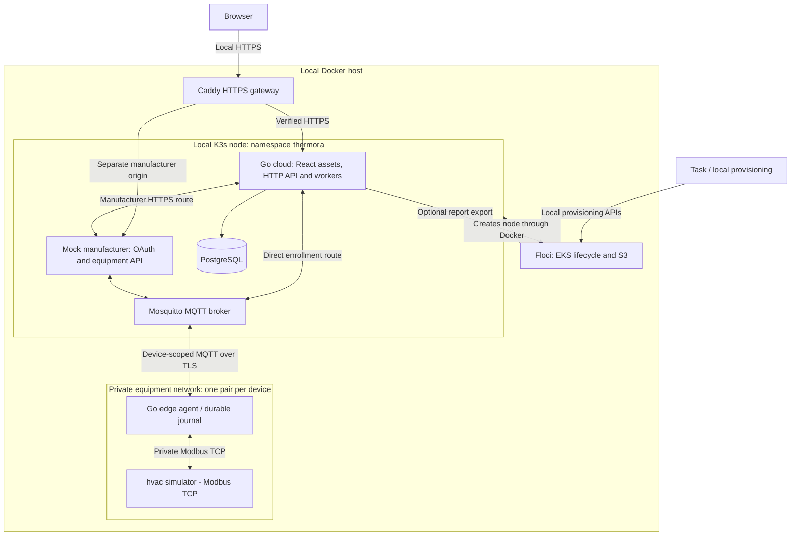
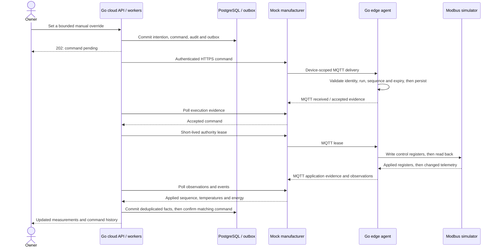

# Architecture

Thermora demonstrates a complete local control loop: enroll a simulated heat pump, collect authenticated observations, choose a control policy, deliver it to equipment, and verify the result with new telemetry. [README](../README.md) covers installation, accounts and demo commands.

## System layout

Docker Compose starts Floci, an HTTPS gateway and equipment containers. Floci's EKS API creates a real local **K3s** node. The dashboard, backend, mock manufacturer, PostgreSQL and MQTT broker run inside that node's `thermora` namespace.

**Deployment choices.** One Go cloud application owns HTTP APIs and background workers and serves the built React/Vite SPA; there is no extra frontend server. Cloud and the manufacturer fixture are separate containers sharing one local Pod lifecycle, with separate secrets and authenticated origins. PostgreSQL and Mosquitto have their own deployments. Edge and equipment stay outside Kubernetes to preserve the device boundary.

**Local cloud services.** Floci provides EKS lifecycle and S3 APIs; EC2/IAM provisioning creates emulator metadata. Docker supplies the actual network. This is local Kubernetes, not managed AWS EKS or proof of AWS compatibility. PostgreSQL and Mosquitto run as ordinary services. No separate k3d profile, Redis, Kafka or service mesh is needed.

**Integration routes.** Manufacturer-enrolled devices exchange telemetry, configuration, commands and receipts through provider HTTPS. The mock provider bridges those requests to MQTT/edge/equipment. Directly claimed devices use cloud-to-edge MQTT. Enrollment selects the route; there is no silent fallback between them.

**Local HTTPS.** `cloud.thermora.io` and `manufacturer.thermora.io` resolve to loopback through explicit host entries. Thermora generates a local CA and server certificates. Caddy verifies upstream TLS; startup rejects public/non-loopback resolution. The localhost fallback uses ports 9443/9444. No public DNS or ACME service is involved.

## Dashboard

The React/Vite dashboard is served by the Go cloud process, with no separate frontend server. Building views separate current operation, proposed schedules, historical observations, command evidence and settings; zone/view selection lives in the URL. TanStack Query owns server state. UI actions keep using the authenticated, versioned OpenAPI contract and the existing control resolver.

ECharts renders separate, aligned axes for each unit with a shared time cursor. Inspection holds plotted data steady while new samples arrive; returning to live applies the latest data. Missing/invalid readings remain gaps, prices can be negative, and inspection/table timestamps include UTC offsets to distinguish repeated daylight-saving hours. Historical coverage and independent model comparisons remain separate. Tables expose chart values without relying on pointer interaction or color. A small blocking local script selects the palette before first paint; dashboard, explorer and manufacturer share tokens and bundled IBM Plex Sans fonts. Theme preferences are stored per origin, never used as authorization state.

## Ownership and onboarding

1. The owner signs up or signs in to Thermora using a local account.
2. The browser visits the separate manufacturer origin. OAuth Authorization Code with PKCE and state delegates device access; access/refresh tokens remain encrypted on the backend.
3. The owner selects authorized equipment, redeems a one-use partner invitation for a new building, supplies preferences and consents to control. Adding a zone to an existing building requires ownership and device consent.
4. The cloud binds organization, building and device. Edge activation exchanges bootstrap proof for scoped MQTT credentials; authenticated telemetry becomes visible.

Owner APIs check building access; fleet dispatch requires an organization operator. Profile edits use optimistic concurrency. Tariff/comfort changes invalidate affected plans and fence stale commands. Disconnect/revocation stops new control and telemetry acceptance while preserving ownership/history. Reconnection requires authorization and consent again; it does not transfer ownership.

## Command execution

One resolver combines intentions in this order: configuration synchronization, manual override, eligible flexibility event, price-aware policy, then baseline. Equipment comfort and anti-cycling protections remain local. Owner opt-out removes automated price/flexibility control.

Publishing, receipt, acceptance, register application and telemetry confirmation are distinct states. A broker acknowledgement is not equipment execution; confirmation does not mean a room has already warmed or money was saved.

The transactional outbox closes the database-commit/message-publish failure window. Delivery is at least once. Device/run identity, configuration generation, sequences, expiry and payload digests prevent stale or conflicting replays. Application receipts acknowledge evidence only after persistence.

During an outage, the edge stores bounded telemetry/events on disk and the cloud refuses fresh remote control for stale devices. Authority leases and the simulator watchdog expire to local baseline. Reconnection reconciles current state before historical evidence drains; duplicates are harmless and old samples cannot make live data look fresh. A full journal rejects new work rather than silently claiming delivery.

## Simulation and results

The Go simulator evolves indoor, outdoor and supply temperature, compressor state, electrical consumption and heat output. Heat loss, thermal inertia, a weather-compensated baseline, efficiency and minimum on/off dwell make commands change subsequent measurements. An optional heating/hot-water model adds a buffer and tank. These are simulation assumptions, not calibrated building models or equipment safety certification.

| Clock / value   | Meaning                                                                                                            |
| --------------- | ------------------------------------------------------------------------------------------------------------------ |
| Simulation time | Physics, weather, prices, energy, schedule windows and dwell; selectable 1×/10×/60× pacing.                        |
| Wall time       | Sessions, delivery expiry, network timeouts, leases, freshness and retention.                                      |
| Observation     | `observed_at` is simulated time; `recorded_at_wall` records actual capture. Cloud receipt is separate.             |
| Units           | Temperatures in °C, telemetry power in W and cumulative energy in Wh; displayed totals in kWh, tariffs in EUR/kWh. |

Weather and price scenarios are packaged and deterministic. The controller evaluates a rolling price-aware schedule within comfort bounds. Missing inputs, stale telemetry or an unsuitable candidate leave the baseline in control; negative prices never override equipment limits. UTC tariff intervals and explicit building timezones handle daylight-saving boundaries.

Controller comparisons use equal initial conditions, inputs and comfort requirements, followed by six hours of recovery. Savings require complete pricing/coverage, no additional comfort violation and equivalent terminal thermal/compressor state. Otherwise the report explains why savings are unavailable. Historical energy uses valid cumulative-counter differences; gaps and unpriced intervals remain visible. Recorded-policy replay approximates sampled evidence and is separate from independent model runs.

Fleet events are bounded, operator-initiated simulations. Eligibility checks freshness, consent, comfort, configuration, alarms and opt-in. Override, disconnect or cancellation removes participation through the same resolver. Power change uses a pre-event reference; it is not verified market delivery. S3 stores optional immutable report exports; storage failure does not block control.

## Storage, security and operations

| Store                           | Persists                                                                                                            |
| ------------------------------- | ------------------------------------------------------------------------------------------------------------------- |
| PostgreSQL PVC                  | Accounts, organizations, buildings, ownership, runs, telemetry, configuration, commands, outbox, audit and reports. |
| Mosquitto and manufacturer PVCs | Broker identity/state and the mock provider's durable journal.                                                      |
| `.local/cloud/`                 | Private credentials/certificates, generated configuration, edge journals and simulator checkpoints.                 |
| Floci Docker volume             | Emulator resources and exported S3 objects.                                                                         |

Native PostgreSQL tables/indexes support bounded history queries. Retention bounds telemetry, receipts and audit/history; no time-series extension is needed for this fleet. Numbered SQL migrations run as an explicit Job. Stop/resume preserves stores. Floci retains the K3s container on shutdown; Thermora stops it explicitly so its node identity and local-volume affinity survive restart. Backup pauses the local system before snapshotting; isolated restore checks do not constitute whole-system disaster recovery.

Sessions use Secure/HttpOnly/SameSite cookies and hashed tokens; passwords use Argon2id. OAuth tokens are encrypted at rest. MQTT uses TLS, per-device identities and exact organization/device ACLs. HTTP/device boundaries validate schemas, ownership, units, timestamps and sizes. Modbus stays on private equipment networks. Floci endpoints and local credentials are explicit; no real AWS credentials are required.

Structured logs correlate requests, devices, runs and commands. Readiness checks the database/schema and broker. Operator diagnostics expose telemetry age, pending delivery, manufacturer failures, execution turnaround and buffer occupancy. [CI](../.github/workflows/ci.yml) covers lint, contracts, race tests, database/MQTT integration and browser/recovery workflows.

## Code map and limits

| Path                                                                                                                              | Responsibility                                                                       |
| --------------------------------------------------------------------------------------------------------------------------------- | ------------------------------------------------------------------------------------ |
| [`cmd/`](../cmd/)                                                                                                                 | Cloud, edge, simulator, mock manufacturer and local administration entry points.     |
| [`internal/cloud/`](../internal/cloud/)                                                                                           | Product APIs, ownership, ingestion, resolver, delivery, history and fleet workflows. |
| [`internal/manufacturer/`](../internal/manufacturer/), [`internal/edge/`](../internal/edge/), [`internal/sim/`](../internal/sim/) | Provider adapter/fixture, protocol translation and independent equipment model.      |
| [`internal/protocol/`](../internal/protocol/)                                                                                     | Message validation and simulated Modbus register encoding.                           |
| [`internal/optimization/`](../internal/optimization/), [`internal/reporting/`](../internal/reporting/)                            | Planning, comparison and covered historical outcomes.                                |
| [`web/`](../web/)                                                                                                                 | React dashboard and bundled API explorer.                                            |
| [`api/`](../api/), [`migrations/`](../migrations/), [`deploy/`](../deploy/)                                                       | API schemas, database changes and reproducible local topology.                       |

HTTP contracts are specification-first: [product OpenAPI](../api/openapi.yaml), [manufacturer OpenAPI](../api/manufacturer.yaml) and [MQTT schemas](../api/mqtt.yaml). `task generate` regenerates Go/TypeScript types; `task contracts:check` checks drift and schema conformance. The [Taskfile](../Taskfile.yml) is the command reference for local work and CI.

The design deliberately runs **one cloud writer, one local Kubernetes node and a catalog capped at 25 devices**. The cap is not a measured capacity claim. Multiple cloud replicas require distributed ownership/fencing, not just a replica-count change. The mock manufacturer models a local household; zones are independent devices, not a coupled hydraulic installation.

Production work still includes real manufacturer/device authorization and safety, calibrated models, account recovery/MFA, credential rotation, high availability, immutable audit storage, complete disaster recovery, disk/counter exhaustion handling and measured service targets. Floci requires Docker-socket access and a privileged node; its Kubernetes API port 16510 is published on all host interfaces with client-certificate authentication. This project is for local development, not public hosting.
